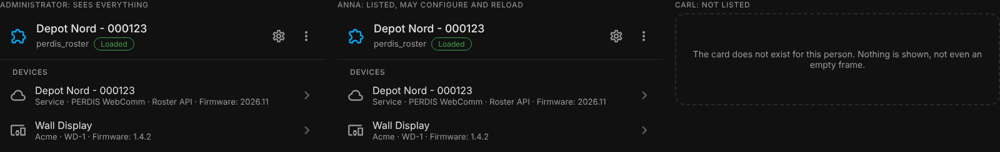

# Config Entry Panel

[🇬🇧 English](README.md) · **🇩🇪 Deutsch**

Eine Home-Assistant-Komponente, die das hinter dem Zahnrad versteckte Recht für die Optionen eines Konfigurationseintrags erweitert, damit auch normale Benutzer Einstellungen einer Integration sehen und ändern können.

Home Assistant hält die Seite eines Integrationseintrags, mit Zahnrad, ⋮-Menü und Geräten, für Administratoren vor. **Config Entry Panel** setzt genau diesen Block auf ein Dashboard und lässt dich pro Person entscheiden, was sie sieht und was sie tun darf. Alle anderen sehen die Karte überhaupt nicht.

<p align="center"></p>

<sub>Alle Bilder in dieser README sind Darstellungen der Karte in einer Demo-Umgebung mit Beispieldaten.</sub>

## Das bekommst du

- **Den Eintragsblock der Einstellungsseite, so kompakt wie dort:** Titel, Integration und Status mit Zahnrad und ⋮-Menü rechts, darunter eine Zeile pro Gerät. Ein Tipp auf ein Gerät öffnet ein Popup (auf Smartphones ein Vollbild-Sheet) mit allen Entitäten, gruppiert wie die Geräteseite (Steuerelemente, Sensoren, Konfiguration, Diagnose); ein Tipp auf den Eintrag zeigt seine Einstellungen.
- **Das Zahnrad für Personen ohne Administratorrechte:** Der Optionen-Dialog der Integration öffnet sich in der Karte und speichert, mit allen Feldtypen, die die Integration nutzt.
- **Neu laden über das Menü.**
- **Rechte pro Person:** Personen auswählen, ankreuzen, was sie sehen (Einstellungen des Eintrags, Geräte und Entitäten) und was sie tun dürfen (Zahnrad, Neu laden). Alles wird auf dem Server gespeichert und durchgesetzt.
- **Entitäten ausblenden** für alle oder für eine Person: per Suche und Checkbox oder ganze Gruppen per regulärem Ausdruck wie `_rssi$`. Ausgeblendete Entitäten verlassen den Server gar nicht erst.
- **Vorschau als Person:** Die Karte genau so sehen, wie die gewählte Person sie sieht, bevor du versehentlich zu viel freigibst.
- **Ohne Rechte unsichtbar:** Wer nicht aufgeführt ist, bekommt keine Karte, keinen Rahmen und keinen Hinweis, dass es sie gibt.
- **Keine manuelle Ressource:** Die Integration liefert die Karte aus und registriert sie selbst.
- **Sprachen:** Englisch, Deutsch, Französisch, Spanisch, Italienisch und Niederländisch. Begriffe, die Home Assistant schon kennt (Geräte, Sensoren, Neu laden, Speichern …), kommen von Home Assistant selbst, in der Sprache deiner Instanz.

## Anwendungsfälle

| Situation | Einrichtung |
| --- | --- |
| **Ein Cloud-Konto, von dem alle im Haushalt abhängen** (Dienstplan, Saugroboter, Auto, Heizung). Es hängt, und nur du kannst neu laden. | Den Haushalt eintragen mit *Sieht: Einstellungen und Geräte, darf neu laden*. Sie sehen den Status und laden selbst neu. |
| **Eine Dienstplan-Integration**, bei der jede Person nur ihre eigene Erinnerungszeit braucht. | Die Person mit *darf die Einstellungen öffnen (Zahnrad)* eintragen. Sie ändert die Optionen in der Karte, sonst nichts in Home Assistant. |
| **Ein Wandtablet im Flur** mit eingeschränktem Benutzer. | Der Person des Tablets nur *Geräte* geben und Diagnose-Rauschen mit `_rssi$` und `_uptime$` ausblenden. |
| **Gäste im Ferienhaus.** | Eine Person mit *Geräte und Entitäten*, ohne Aktionen, und ein Muster, das alles außer dem Nötigen ausblendet. |
| **Ein technikaffiner Verwandter**, der Dinge neu starten, aber nicht an deinem System arbeiten soll. | *Neu laden* für diese Person, sonst nichts. |
| **Testen, bevor du teilst.** | Editor öffnen, *Vorschau als* wählen, prüfen, dann die Person hinzufügen. |

## Installation

1. Öffne dieses Repository mit dem Badge im [englischen README](README.md) in HACS, oder füge es als **benutzerdefiniertes Repository** mit der Kategorie **Integration** hinzu (**Einstellungen → Marketplace** ab Home Assistant 2026.11). Herunterladen und Home Assistant neu starten.
2. Füge **Config Entry Panel** unter **Einstellungen → Geräte & Dienste** hinzu. Es gibt nichts zu konfigurieren.
3. Lade den Browser einmal neu, bearbeite ein Dashboard, **Karte hinzufügen → Config entry panel** und wähle den Konfigurationseintrag.
4. Füge unter *Wer diese Karte sieht* die Personen hinzu und kreuze an, was sie sehen und tun dürfen.

```yaml
type: custom:config-entry-panel
entry_id: 01J8Q2X5N7K3M4P9R6T1V0W8YZ   # im Editor gewählt
title: Dienstplan                      # optional
```

Nur diese zwei Optionen stehen in der Karte. Wer was sieht, speichert die Integration auf dem Server, deshalb gilt es auf jedem Dashboard, das den Eintrag zeigt.

## So funktioniert es

Einem Browser darf man keine Rechte anvertrauen, und Home Assistant verweigert normalen Benutzern den Großteil der Einstellungs-API. Das Panel ist deshalb ein kleines, schmales Tor auf dem Server:

- Jede Anfrage trägt den Benutzer der WebSocket-Verbindung. Die Integration ordnet ihn seiner Person-Entität zu und schlägt die Regeln nach, die ein Administrator gespeichert hat. Nichts, was das Dashboard sendet, kann sie erweitern.
- Die Daten der Karte, auch Geräte und Entitäten, werden auf dem Server zusammengestellt und schon gefiltert. Ausgeblendete Entitäten sind nicht nur im Browser versteckt.
- Das Zahnrad startet Home Assistants eigenen Optionen-Flow, von der Integration für den Benutzer gestartet. Ein Flow kann nur von dem Benutzer fortgesetzt werden, der ihn gestartet hat.
- Administratoren sehen immer alles und verwalten die Regeln. Alle anderen bekommen ohne Regel nichts.

Ausblende-Muster werden auf dem Server geprüft: sehr lange und solche, die minutenlang laufen könnten (eine wiederholte Gruppe, die sich selbst wiederholt), werden abgelehnt, weil sie bei den Anfragen anderer Personen laufen würden.

## Einschränkungen

- Wer das Zahnrad öffnen darf, kann **jede Option** dieser Integration ändern, wie ein Administrator in den Einstellungen. Vergib es, als würdest du jemandem einen Schraubendreher in die Hand geben.
- Abgedeckt sind nur die *Optionen* einer Integration, nicht Neukonfigurieren, Untereinträge, Umbenennen, Deaktivieren oder Löschen.
- In der Karte ausgeblendete Entitäten sind für angemeldete Benutzer an anderen Stellen von Home Assistant weiter sichtbar (Entitätssuche, WebSocket-API). Ausblenden dient einer aufgeräumten Karte, nicht Geheimnissen.
- Ein Benutzer braucht eine **Person**-Entität, die mit seinem Benutzer verknüpft ist. Benutzer ohne Person sehen die Karte nie.
- Regeln eines gelöschten Konfigurationseintrags bleiben in der Speicherdatei und haben keine Wirkung.

## Kompatibilität

| | |
| --- | --- |
| Home Assistant | **2024.7 und neuer.** Echt getestet, mit dem echten Core, von 2024.7 bis 2026.9 (Python 3.12 bis 3.14); der Compatibility-Workflow testet die folgenden Releases weiter und senkt das Minimum, soweit die Tests bestehen. |
| Dashboards | Masonry- und Bereichsansicht, Bearbeitungsmodus, YAML-Modus. Die Karte meldet ihre Größe an das Bereichslayout. |
| Browser und Smartphones | Aktuelle Versionen von Chrome, Edge, Firefox und Safari sowie die Home-Assistant-Apps. Smartphone zuerst gebaut: nichts ist breiter als der Bildschirm, Popups sind Vollbild-Sheets, Touch-Ziele haben 44 px. |
| Installation | HACS und Marketplace (Kategorie *Integration*), oder `custom_components/config_entry_panel` von Hand kopieren. |
| Größe | Ein 78-kB-Skript, nur auf Seiten mit Dashboards geladen. |

## Aktuell bleiben

Schlägt eine Anfrage fehl, behält die Karte, was sie zeigt, und versucht es erneut (nach 2, 5, 15, dann alle 60 Sekunden). Sie fragt neu, wenn die WebSocket-Verbindung zurückkommt, wenn die Seite aus dem Hintergrund zurückkehrt und alle fünf Minuten, solange sie sichtbar ist. Nur die Antwort des Servers *du darfst diese Karte nicht sehen* blendet sie aus.

## Fehlersuche

| Symptom | Ursache |
| --- | --- |
| Die Karte erscheint nicht in der Kartenauswahl | Browser nach dem ersten Start neu laden; die Integration registriert die Karte beim Laden. Im Log unter **Einstellungen → System → Protokolle** nach "card file" suchen. |
| Ein Administrator sieht *Die Integration Config Entry Panel ist nicht eingerichtet* | Integration unter **Einstellungen → Geräte & Dienste** hinzufügen. |
| Eine Person sieht nichts | Sie ist nicht aufgeführt, hat keinen Bereich angekreuzt, oder ihr Benutzer ist keiner Person zugeordnet. Mit *Vorschau als* siehst du den Grund. |
| Das Zahnrad fehlt | Die Person hat nicht *die Einstellungen öffnen*, oder die Integration hat keine Optionen. |

## Entwicklung

```bash
cd frontend
npm ci
npm test            # Logik, Übersetzungen, WebSocket-Aufrufe
npm run lint        # Typprüfung
npm run build       # schreibt custom_components/config_entry_panel/frontend/config-entry-panel.js
npm run e2e         # steuert die gebaute Karte in einem Browser gegen ein nachgebautes Home Assistant (braucht Playwright)
npm run screenshots # erzeugt docs/images
```

Die Python-Seite hat einfache Unit-Tests in `.github/tests` und Tests gegen einen echten Home-Assistant-Core in `.github/ha_tests`; die CI führt beide für jedes unterstützte Release aus.

## Releases

Versionen folgen `YYYY.MM.DD`, mit `.1`, `.2` für weitere Builds eines Tages. Eine neue Version auf `main` veröffentlicht das HACS-ZIP als neuestes Release.
