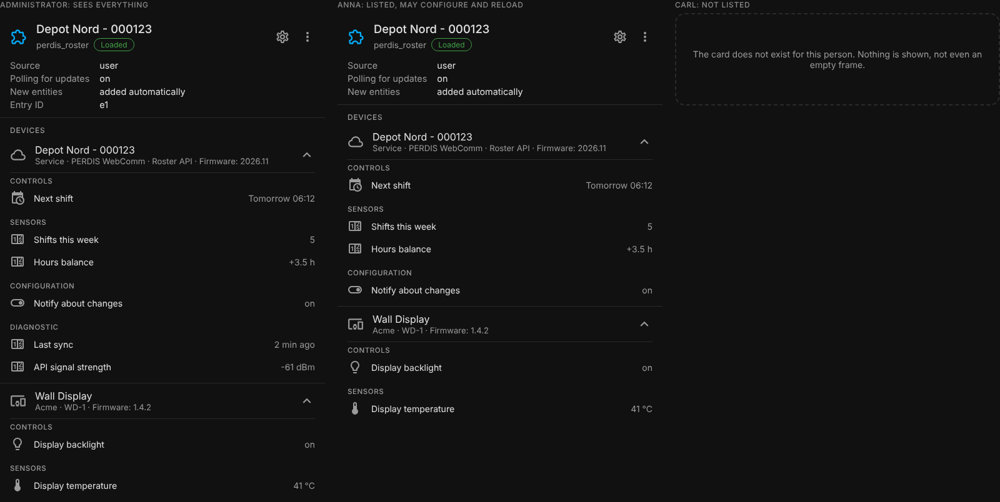

<!-- header:begin (generated from project metadata) -->
<h1 align="center">
  <picture>
    <source media="(prefers-color-scheme: dark)" srcset="https://raw.githubusercontent.com/seb5594/hass-config_entry_panel-integration/main/custom_components/config_entry_panel/brand/dark_logo@2x.png">
    
  </picture>
  <br>
  Config Entry Panel
</h1>

<p align="center">
  <a href="https://my.home-assistant.io/redirect/hacs_repository/?owner=seb5594&amp;repository=hass-config_entry_panel-integration&amp;category=integration"></a>
  <a href="https://github.com/seb5594/hass-config_entry_panel-integration/actions/workflows/compat.yml"></a><br>
  <a href="https://github.com/seb5594/hass-config_entry_panel-integration/releases"></a>
  <a href="https://github.com/seb5594/hass-config_entry_panel-integration/releases"></a><br>
  <a href="https://github.com/seb5594/hass-config_entry_panel-integration/stargazers"></a>
  <a href="https://github.com/seb5594/hass-config_entry_panel-integration/forks"></a>
  <a href="https://github.com/seb5594/hass-config_entry_panel-integration/actions/workflows/ci.yml"></a>
  <a href="https://github.com/seb5594/hass-config_entry_panel-integration/issues"></a><br>
  <a href="https://paypal.me/seb5594"></a>
  <a href="https://buymeacoffee.com/seb5594"></a><br>
  <a href="https://github.com/seb5594/hass-config_entry_panel-integration#license"></a>
</p>
<!-- header:end -->

**🇬🇧 English** · [🇩🇪 Deutsch](README.de.md)

A custom Home Assistant component to modify the config entry option permission hidden by a gear, to allow regular users to see and set integration settings.

Home Assistant keeps the page of an integration entry, with its gear, its ⋮ menu and its devices, for administrators. **Config Entry Panel** puts exactly that block on a dashboard and lets you decide, per person, what they see and what they may do. Everybody else does not see the card at all.

<p align="center"></p>

<sub>All images in this README are renderings of the card in a demo environment with sample data.</sub>

## What you get

- **The entry block of the settings page:** title, integration, state, the gear and a ⋮ menu, then the devices with their entities, grouped like the device page (controls, sensors, configuration, diagnostic).
- **The gear for people who are not administrators:** the integration's own options dialog opens in the card and saves, with every field type the integration uses.
- **Reload from the menu.**
- **Rights per person:** pick persons, tick what they see (entry settings, devices and entities) and what they may do (gear, reload). Everything is saved and enforced on the server.
- **Hide entities** for everybody or for one person: tick them, or hide whole families with regular expressions such as `_rssi$`. Hidden entities never leave the server.
- **Preview as person:** see the card exactly as a chosen person sees it, before you share anything by accident.
- **Invisible without rights:** a person who is not listed gets no card, no frame, no hint that it exists.
- **No manual resource:** the integration serves the card and registers it by itself.
- **Language:** English, German, French, Spanish, Italian and Dutch. Words Home Assistant already knows (devices, sensors, reload, save …) come from Home Assistant itself in whatever language your instance speaks.

## Use cases

| Situation | What you set up |
| --- | --- |
| **A cloud account everybody in the household depends on** (roster, robot vacuum, car, heating). It hangs, and only you can reload it. | List the household as *Sees: settings and devices, may reload*. They see the state and reload it themselves. |
| **A shift or roster integration** where each person only needs their own reminder time. | List the person with *may open the settings (gear)*. They change the options in the card, nothing else in Home Assistant. |
| **A wall tablet in the hallway** with a restricted user. | Give the tablet's person *devices* only and hide diagnostic noise with `_rssi$` and `_uptime$`. |
| **Guests in a holiday home.** | One person with *devices and entities*, no actions, and a pattern that hides everything except what guests need. |
| **A tech-savvy relative** who should restart things but not touch your system. | *Reload* for this person, nothing else. |
| **Testing before sharing.** | Open the editor, choose *Preview as*, check, then add the person. |

## Install

1. Open this repository in HACS with the badge above, or add it as a **custom repository** with the category **Integration** (**Settings → Marketplace** on Home Assistant 2026.11 and newer). Download it and restart Home Assistant.
2. Add **Config Entry Panel** under **Settings → Devices & services**. There is nothing to configure.
3. Reload your browser once, edit a dashboard, **Add card → Config entry panel**, and choose the config entry.
4. Under *Who sees this card* add the people and tick what they may see and do.

```yaml
type: custom:config-entry-panel
entry_id: 01J8Q2X5N7K3M4P9R6T1V0W8YZ   # chosen in the editor
title: Roster                          # optional
```

Only these two options live in the card. Who sees what is stored by the integration on the server, so it is the same on every dashboard that shows the entry.

## How it works

A browser cannot be trusted with permissions, and Home Assistant refuses most of the settings API to regular users. So the panel works like a small, narrow gate on the server:

- Every request carries the user of the websocket connection. The integration maps the user to their person entity and looks up the rules an administrator saved. Nothing the dashboard sends can widen them.
- The data of the card, including the devices and entities, is assembled on the server and already filtered. Hidden entities are not merely hidden in the browser.
- The gear runs Home Assistant's own options flow, started for the user by the integration. A flow can only be continued by the user who started it.
- Administrators always see everything and manage the rules. Everybody else gets nothing without a rule.

Hiding patterns are checked on the server: very long ones and ones that could run for minutes (a repeated group that repeats itself) are refused, because they would run on other people's requests.

## Limits

- A person who may open the gear can change **every option** of that integration, as an administrator could in the settings. Grant it like you would hand over a screwdriver.
- Only the *options* of an integration are covered, not reconfigure, sub-entries, rename, disable or delete.
- Entities hidden in the card are still visible to logged-in users through other parts of Home Assistant (the entity search, the websocket API). Hiding is for a tidy card, not for secrets.
- A user needs a **person** entity that is linked to their user. Users without a person never see the card.
- Rules of a config entry that you delete stay in the storage file and have no effect.

## Compatibility

| | |
| --- | --- |
| Home Assistant | **2024.11 and newer.** Tested for real, with the real core, on 2024.11, 2025.1, 2025.12, 2026.2 and 2026.9 (Python 3.12 to 3.14); the compatibility workflow keeps testing the releases that follow. |
| Dashboards | Masonry and sections view, edit mode, YAML mode. The card reports its size to the sections layout. |
| Browsers | Current Chrome, Edge, Firefox and Safari, and the Home Assistant apps. |
| Installation | HACS and the Marketplace (category *Integration*), or copy `custom_components/config_entry_panel` by hand. |
| Size | One 72 kB script, loaded only on pages that show dashboards. |

Suggested GitHub topics for the repository: `home-assistant`, `hacs`, `hacs-integration`, `home-assistant-custom-component`, `lovelace`, `lovelace-card`, `dashboard`, `config-entry`, `options-flow`, `permissions`.

## Troubleshooting

| Symptom | Reason |
| --- | --- |
| The card does not show up in the card picker | Reload the browser after the first start; the integration registers the card when it loads. Check **Settings → System → Logs** for "card file". |
| An administrator sees *The Config Entry Panel integration is not set up* | Add the integration under **Settings → Devices & services**. |
| A person sees nothing | They are not listed, have no section ticked, or their user is not linked to a person entity. Use *Preview as* to see why. |
| The gear is missing | The person does not have *open the settings*, or the integration has no options. |

## Development

```bash
cd frontend
npm ci
npm test            # logic, translations, websocket calls
npm run lint        # type check
npm run build       # writes custom_components/config_entry_panel/frontend/config-entry-panel.js
npm run e2e         # drives the built card in a browser against a stand-in Home Assistant (needs Playwright)
npm run screenshots # renders docs/images
```

The Python side has plain unit tests in `.github/tests` and tests against a real Home Assistant core in `.github/ha_tests`; the CI runs both for every supported release.

## Releases

The first releases are **pre-releases** (`2026.11.26b1`, `b2` …) until the panel has proven itself. Versions follow `YYYY.MM.DD`, with `.1`, `.2` for further builds of a day.

<!-- support:begin (generated, shared text) -->
## Say thanks

All my projects are built in my spare time, just for the fun of it. Still, they take a lot of time and care, and many of the smart home gadgets I buy end up here because I want to make them cloud-free and smart-home ready. Every bit of support means a lot to me.

If my work helped you or turned out to be useful, show your appreciation with a hot drink for my next sleepless night.

[](https://paypal.me/seb5594) [](https://buymeacoffee.com/seb5594)
<!-- support:end -->

<!-- license:begin (generated from the license file) -->
## License

[](LICENSE)

Published under the [Apache License 2.0](LICENSE).
<!-- license:end -->
